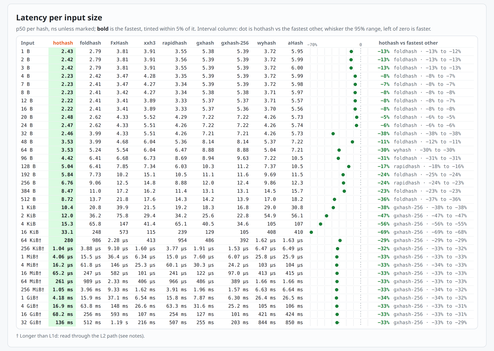

# hothash

> A fast, non-cryptographic hash function for the hot path on modern x86-64 CPUs.

Hothash selects one of two modes based on input length:

- **0-352 bytes:** scalar wide-multiply mixing.
- **353+ bytes:** eight-way AVX-512/VAES mixing.

## Usage

```rust
// Direct
let keys = hothash::Keys::new(seed);
let h = hothash::hash_with(&keys, b"hello");

// With `HashMap`
let mut map: hothash::HashMap<String, u32> = hothash::HashMap::default();
map.insert("hello".into(), 1); // or std::collections::HashMap::with_hasher(keys)
```

Requires AVX-512 F/BW/VL, VAES, AES, and BMI2. Build with `RUSTFLAGS="-C target-cpu=native"` on a supported CPU (Zen 4/5 or Ice Lake and newer).

Not suitable for cryptographic use.


